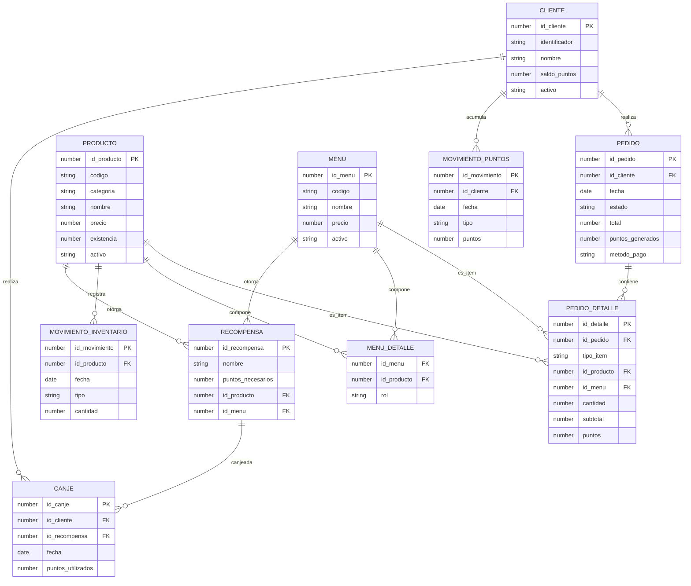
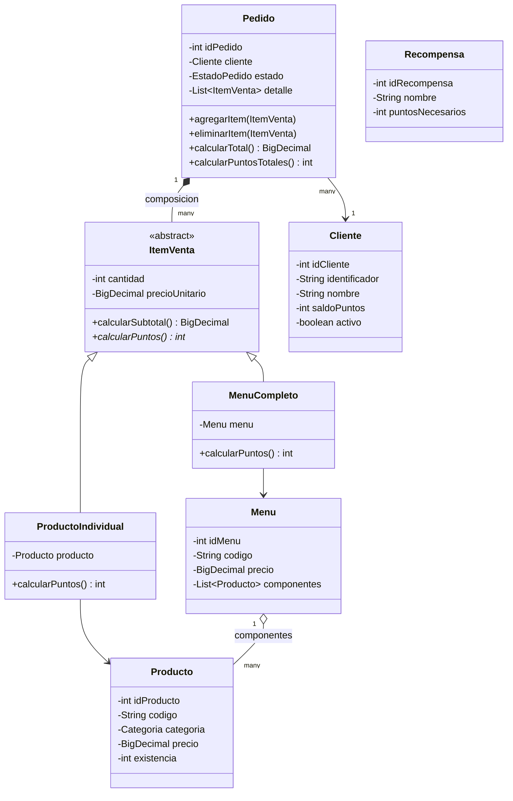

# Pan, Puntos y Premios — Documento de diseño

Sistema de gestión de pedidos y fidelización para restaurante de sándwiches. Java + Swing + Oracle Database, JDBC con `PreparedStatement`.

---

## 1. Resumen de módulos

| Módulo | Responsabilidad |
|---|---|
| Clientes | Registro, búsqueda, saldo de puntos, historial |
| Productos | Catálogo (sándwich, bebida, acompañamiento) |
| Inventario | Abastecimiento y control de existencias |
| Pedidos | Selección de productos/menús, cálculo de totales |
| Cobro | Pago en efectivo o tarjeta |
| Fidelización | Acumulación y canje de puntos |
| Reportes | Ventas, inventario, movimientos, JTable |

---

## 2. Diagrama entidad-relación



**Decisiones de diseño clave**

- `menu_detalle` es tabla puente entre `menu` y `producto`: evita tratar el menú como un "cuarto producto" al descontar inventario.
- `pedido_detalle` usa `tipo_item` + dos FK opcionales (`id_producto` / `id_menu`) con un `CHECK` que exige que exactamente una esté llena. Así un mismo pedido mezcla sándwiches sueltos, bebidas y menús.
- `movimiento_inventario` y `movimiento_puntos` son históricos append-only: nunca se actualiza `existencia` o `saldo_puntos` sin dejar rastro (caso de uso 5).
- `recompensa` apunta a un producto **o** a un menú, nunca a ambos ni a ninguno.

---

## 3. Script DDL (Oracle)

```sql
CREATE TABLE cliente (
    id_cliente NUMBER GENERATED ALWAYS AS IDENTITY PRIMARY KEY,
    identificador VARCHAR2(20) NOT NULL UNIQUE,
    nombre VARCHAR2(100) NOT NULL,
    telefono VARCHAR2(20),
    email VARCHAR2(100),
    saldo_puntos NUMBER DEFAULT 0 NOT NULL,
    activo CHAR(1) DEFAULT 'S' NOT NULL,
    fecha_registro DATE DEFAULT SYSDATE NOT NULL,
    CONSTRAINT ck_cliente_puntos CHECK (saldo_puntos >= 0),
    CONSTRAINT ck_cliente_activo CHECK (activo IN ('S', 'N'))
);

CREATE TABLE producto (
    id_producto NUMBER GENERATED ALWAYS AS IDENTITY PRIMARY KEY,
    codigo VARCHAR2(20) NOT NULL UNIQUE,
    categoria VARCHAR2(20) NOT NULL,
    nombre VARCHAR2(100) NOT NULL,
    precio NUMBER(10, 2) NOT NULL,
    existencia NUMBER DEFAULT 0 NOT NULL,
    activo CHAR(1) DEFAULT 'S' NOT NULL,
    CONSTRAINT ck_producto_precio CHECK (precio >= 0),
    CONSTRAINT ck_producto_existencia CHECK (existencia >= 0),
    CONSTRAINT ck_producto_categoria CHECK (categoria IN ('SANDWICH', 'BEBIDA', 'ACOMPANAMIENTO')),
    CONSTRAINT ck_producto_activo CHECK (activo IN ('S', 'N'))
);

CREATE TABLE menu (
    id_menu NUMBER GENERATED ALWAYS AS IDENTITY PRIMARY KEY,
    codigo VARCHAR2(20) NOT NULL UNIQUE,
    nombre VARCHAR2(100) NOT NULL,
    precio NUMBER(10, 2) NOT NULL,
    activo CHAR(1) DEFAULT 'S' NOT NULL,
    CONSTRAINT ck_menu_precio CHECK (precio >= 0),
    CONSTRAINT ck_menu_activo CHECK (activo IN ('S', 'N'))
);

CREATE TABLE menu_detalle (
    id_menu NUMBER NOT NULL,
    id_producto NUMBER NOT NULL,
    rol VARCHAR2(20) NOT NULL,
    CONSTRAINT pk_menu_detalle PRIMARY KEY (id_menu, id_producto),
    CONSTRAINT fk_menudet_menu FOREIGN KEY (id_menu) REFERENCES menu(id_menu),
    CONSTRAINT fk_menudet_producto FOREIGN KEY (id_producto) REFERENCES producto(id_producto),
    CONSTRAINT ck_menudet_rol CHECK (rol IN ('SANDWICH', 'BEBIDA', 'ACOMPANAMIENTO'))
);

CREATE TABLE pedido (
    id_pedido NUMBER GENERATED ALWAYS AS IDENTITY PRIMARY KEY,
    id_cliente NUMBER NOT NULL,
    fecha DATE DEFAULT SYSDATE NOT NULL,
    estado VARCHAR2(15) DEFAULT 'PENDIENTE' NOT NULL,
    total NUMBER(10, 2) DEFAULT 0 NOT NULL,
    puntos_generados NUMBER DEFAULT 0 NOT NULL,
    metodo_pago VARCHAR2(10),
    referencia_pago VARCHAR2(50),
    CONSTRAINT fk_pedido_cliente FOREIGN KEY (id_cliente) REFERENCES cliente(id_cliente),
    CONSTRAINT ck_pedido_estado CHECK (estado IN ('PENDIENTE', 'PAGADO', 'ENTREGADO', 'ANULADO')),
    CONSTRAINT ck_pedido_metodo CHECK (metodo_pago IN ('EFECTIVO', 'TARJETA')),
    CONSTRAINT ck_pedido_total CHECK (total >= 0)
);

CREATE TABLE pedido_detalle (
    id_detalle NUMBER GENERATED ALWAYS AS IDENTITY PRIMARY KEY,
    id_pedido NUMBER NOT NULL,
    tipo_item VARCHAR2(10) NOT NULL,
    id_producto NUMBER,
    id_menu NUMBER,
    cantidad NUMBER NOT NULL,
    precio_unitario NUMBER(10, 2) NOT NULL,
    subtotal NUMBER(10, 2) NOT NULL,
    puntos NUMBER DEFAULT 0 NOT NULL,
    CONSTRAINT fk_detalle_pedido FOREIGN KEY (id_pedido) REFERENCES pedido(id_pedido),
    CONSTRAINT fk_detalle_producto FOREIGN KEY (id_producto) REFERENCES producto(id_producto),
    CONSTRAINT fk_detalle_menu FOREIGN KEY (id_menu) REFERENCES menu(id_menu),
    CONSTRAINT ck_detalle_tipo CHECK (tipo_item IN ('PRODUCTO', 'MENU')),
    CONSTRAINT ck_detalle_cantidad CHECK (cantidad > 0),
    CONSTRAINT ck_detalle_referencia CHECK (
        (tipo_item = 'PRODUCTO' AND id_producto IS NOT NULL AND id_menu IS NULL) OR
        (tipo_item = 'MENU' AND id_menu IS NOT NULL AND id_producto IS NULL)
    )
);

CREATE TABLE movimiento_inventario (
    id_movimiento NUMBER GENERATED ALWAYS AS IDENTITY PRIMARY KEY,
    id_producto NUMBER NOT NULL,
    fecha DATE DEFAULT SYSDATE NOT NULL,
    tipo VARCHAR2(15) NOT NULL,
    cantidad NUMBER NOT NULL,
    existencia_resultante NUMBER NOT NULL,
    CONSTRAINT fk_movinv_producto FOREIGN KEY (id_producto) REFERENCES producto(id_producto),
    CONSTRAINT ck_movinv_tipo CHECK (tipo IN ('ABASTECIMIENTO', 'VENTA', 'CANJE'))
);

CREATE TABLE movimiento_puntos (
    id_movimiento NUMBER GENERATED ALWAYS AS IDENTITY PRIMARY KEY,
    id_cliente NUMBER NOT NULL,
    fecha DATE DEFAULT SYSDATE NOT NULL,
    tipo VARCHAR2(15) NOT NULL,
    puntos NUMBER NOT NULL,
    referencia VARCHAR2(50),
    CONSTRAINT fk_movpts_cliente FOREIGN KEY (id_cliente) REFERENCES cliente(id_cliente),
    CONSTRAINT ck_movpts_tipo CHECK (tipo IN ('ACUMULACION', 'CANJE'))
);

CREATE TABLE recompensa (
    id_recompensa NUMBER GENERATED ALWAYS AS IDENTITY PRIMARY KEY,
    nombre VARCHAR2(100) NOT NULL,
    puntos_necesarios NUMBER NOT NULL,
    id_producto NUMBER,
    id_menu NUMBER,
    activo CHAR(1) DEFAULT 'S' NOT NULL,
    CONSTRAINT fk_recompensa_producto FOREIGN KEY (id_producto) REFERENCES producto(id_producto),
    CONSTRAINT fk_recompensa_menu FOREIGN KEY (id_menu) REFERENCES menu(id_menu),
    CONSTRAINT ck_recompensa_puntos CHECK (puntos_necesarios > 0),
    CONSTRAINT ck_recompensa_activo CHECK (activo IN ('S', 'N')),
    CONSTRAINT ck_recompensa_item CHECK (
        (id_producto IS NOT NULL AND id_menu IS NULL) OR
        (id_menu IS NOT NULL AND id_producto IS NULL)
    )
);

CREATE TABLE canje (
    id_canje NUMBER GENERATED ALWAYS AS IDENTITY PRIMARY KEY,
    id_cliente NUMBER NOT NULL,
    id_recompensa NUMBER NOT NULL,
    fecha DATE DEFAULT SYSDATE NOT NULL,
    puntos_utilizados NUMBER NOT NULL,
    CONSTRAINT fk_canje_cliente FOREIGN KEY (id_cliente) REFERENCES cliente(id_cliente),
    CONSTRAINT fk_canje_recompensa FOREIGN KEY (id_recompensa) REFERENCES recompensa(id_recompensa),
    CONSTRAINT ck_canje_puntos CHECK (puntos_utilizados > 0)
);

INSERT INTO cliente (identificador, nombre, telefono, email) VALUES ('CLI001', 'Juan Perez', '55551234', 'juan.perez@correo.com');
INSERT INTO cliente (identificador, nombre, telefono, email) VALUES ('CLI002', 'Maria Lopez', '55555678', 'maria.lopez@correo.com');

INSERT INTO producto (codigo, categoria, nombre, precio, existencia) VALUES ('SAN001', 'SANDWICH', 'Sandwich de pollo', 25.00, 25);
INSERT INTO producto (codigo, categoria, nombre, precio, existencia) VALUES ('SAN002', 'SANDWICH', 'Sandwich de jamon', 22.00, 20);
INSERT INTO producto (codigo, categoria, nombre, precio, existencia) VALUES ('BEB001', 'BEBIDA', 'Gaseosa', 8.00, 50);
INSERT INTO producto (codigo, categoria, nombre, precio, existencia) VALUES ('ACO001', 'ACOMPANAMIENTO', 'Papas', 10.00, 35);

INSERT INTO menu (codigo, nombre, precio) VALUES ('MEN001', 'Menu completo de pollo', 37.00);

INSERT INTO menu_detalle (id_menu, id_producto, rol)
    SELECT m.id_menu, p.id_producto, 'SANDWICH' FROM menu m, producto p WHERE m.codigo = 'MEN001' AND p.codigo = 'SAN001';
INSERT INTO menu_detalle (id_menu, id_producto, rol)
    SELECT m.id_menu, p.id_producto, 'BEBIDA' FROM menu m, producto p WHERE m.codigo = 'MEN001' AND p.codigo = 'BEB001';
INSERT INTO menu_detalle (id_menu, id_producto, rol)
    SELECT m.id_menu, p.id_producto, 'ACOMPANAMIENTO' FROM menu m, producto p WHERE m.codigo = 'MEN001' AND p.codigo = 'ACO001';

INSERT INTO recompensa (nombre, puntos_necesarios, id_producto)
    SELECT 'Bebida gratuita', 10, id_producto FROM producto WHERE codigo = 'BEB001';
INSERT INTO recompensa (nombre, puntos_necesarios, id_producto)
    SELECT 'Acompanamiento gratuito', 15, id_producto FROM producto WHERE codigo = 'ACO001';
INSERT INTO recompensa (nombre, puntos_necesarios, id_producto)
    SELECT 'Sandwich individual gratuito', 30, id_producto FROM producto WHERE codigo = 'SAN001';
INSERT INTO recompensa (nombre, puntos_necesarios, id_menu)
    SELECT 'Menu completo gratuito', 50, id_menu FROM menu WHERE codigo = 'MEN001';

COMMIT;
```

---

## 4. Modelo de clases Java

### 4.1 Diagrama de clases



Herencia y polimorfismo: `ItemVenta` es abstracta y declara `calcularPuntos()`; `ProductoIndividual` retorna `2 * cantidad` y `MenuCompleto` retorna `8 * cantidad`. `Pedido.calcularPuntosTotales()` itera el `ArrayList<ItemVenta>` sin conocer el tipo concreto de cada elemento — ahí está la justificación real del polimorfismo, no solo el cumplimiento del requisito.

### 4.2 Paquetes sugeridos

```
com.panpuntospremios
├── modelo        (Cliente, Producto, Menu, Pedido, ItemVenta, ProductoIndividual, MenuCompleto, Recompensa)
├── enums          (Categoria, EstadoPedido, MetodoPago, TipoItem, TipoMovimiento)
├── excepcion      (StockInsuficienteException, PuntosInsuficientesException, PagoRechazadoException)
├── dao            (ClienteDAO, ProductoDAO, MenuDAO, PedidoDAO, RecompensaDAO + interfaces)
├── servicio       (VentaServicio, InventarioServicio, FidelizacionServicio)
├── util           (ConexionOracle)
└── vista          (FormClientes, FormProductos, FormInventario, FormPedido, FormCobro, FormFidelizacion, FormReportes)
```

### 4.3 Clase abstracta `ItemVenta`

```java
public abstract class ItemVenta {
    private int cantidad;
    private BigDecimal precioUnitario;

    public ItemVenta(int cantidad, BigDecimal precioUnitario) {
        this.cantidad = cantidad;
        this.precioUnitario = precioUnitario;
    }

    public BigDecimal calcularSubtotal() {
        return precioUnitario.multiply(BigDecimal.valueOf(cantidad));
    }

    public abstract int calcularPuntos();

    public int getCantidad() {
        return cantidad;
    }

    public BigDecimal getPrecioUnitario() {
        return precioUnitario;
    }
}
```

### 4.4 `ProductoIndividual` y `MenuCompleto`

```java
public class ProductoIndividual extends ItemVenta {
    private Producto producto;

    public ProductoIndividual(Producto producto, int cantidad) {
        super(cantidad, producto.getPrecio());
        this.producto = producto;
    }

    @Override
    public int calcularPuntos() {
        return getCantidad() * 2;
    }

    public Producto getProducto() {
        return producto;
    }
}

public class MenuCompleto extends ItemVenta {
    private Menu menu;

    public MenuCompleto(Menu menu, int cantidad) {
        super(cantidad, menu.getPrecio());
        this.menu = menu;
    }

    @Override
    public int calcularPuntos() {
        return getCantidad() * 8;
    }

    public Menu getMenu() {
        return menu;
    }
}
```

Nota: bebidas y acompañamientos vendidos sueltos deben representarse como `ProductoIndividual` cuyo `calcularPuntos()` general retorna `cantidad * 2` solo si `producto.getCategoria() == Categoria.SANDWICH`; de lo contrario retorna 0. Ajusta la condición dentro de `calcularPuntos()` según la categoría del producto.

### 4.5 `Pedido` (composición + `ArrayList`)

```java
public class Pedido {
    private int idPedido;
    private Cliente cliente;
    private EstadoPedido estado;
    private List<ItemVenta> detalle;

    public Pedido(Cliente cliente) {
        this.cliente = cliente;
        this.estado = EstadoPedido.PENDIENTE;
        this.detalle = new ArrayList<>();
    }

    public void agregarItem(ItemVenta item) {
        detalle.add(item);
    }

    public void eliminarItem(ItemVenta item) {
        detalle.remove(item);
    }

    public BigDecimal calcularTotal() {
        BigDecimal total = BigDecimal.ZERO;
        for (ItemVenta item : detalle) {
            total = total.add(item.calcularSubtotal());
        }
        return total;
    }

    public int calcularPuntosTotales() {
        int puntos = 0;
        for (ItemVenta item : detalle) {
            puntos += item.calcularPuntos();
        }
        return puntos;
    }

    public List<ItemVenta> getDetalle() {
        return detalle;
    }

    public EstadoPedido getEstado() {
        return estado;
    }

    public void setEstado(EstadoPedido estado) {
        this.estado = estado;
    }
}
```

### 4.6 Capa DAO (patrón con `PreparedStatement`)

```java
public interface ClienteDAO {
    Cliente buscarPorIdentificador(String identificador) throws SQLException;
    void registrar(Cliente cliente) throws SQLException;
    void actualizarPuntos(int idCliente, int nuevoSaldo) throws SQLException;
}

public class ClienteDAOImpl implements ClienteDAO {
    private Connection conexion;

    public ClienteDAOImpl(Connection conexion) {
        this.conexion = conexion;
    }

    @Override
    public Cliente buscarPorIdentificador(String identificador) throws SQLException {
        String sql = "SELECT id_cliente, identificador, nombre, saldo_puntos, activo "
                + "FROM cliente WHERE identificador = ?";
        try (PreparedStatement ps = conexion.prepareStatement(sql)) {
            ps.setString(1, identificador);
            try (ResultSet rs = ps.executeQuery()) {
                if (rs.next()) {
                    return new Cliente(
                        rs.getInt("id_cliente"),
                        rs.getString("identificador"),
                        rs.getString("nombre"),
                        rs.getInt("saldo_puntos"),
                        "S".equals(rs.getString("activo"))
                    );
                }
                return null;
            }
        }
    }

    @Override
    public void registrar(Cliente cliente) throws SQLException {
        String sql = "INSERT INTO cliente (identificador, nombre, telefono, email) VALUES (?, ?, ?, ?)";
        try (PreparedStatement ps = conexion.prepareStatement(sql)) {
            ps.setString(1, cliente.getIdentificador());
            ps.setString(2, cliente.getNombre());
            ps.setString(3, cliente.getTelefono());
            ps.setString(4, cliente.getEmail());
            ps.executeUpdate();
        }
    }

    @Override
    public void actualizarPuntos(int idCliente, int nuevoSaldo) throws SQLException {
        String sql = "UPDATE cliente SET saldo_puntos = ? WHERE id_cliente = ?";
        try (PreparedStatement ps = conexion.prepareStatement(sql)) {
            ps.setInt(1, nuevoSaldo);
            ps.setInt(2, idCliente);
            ps.executeUpdate();
        }
    }
}
```

### 4.7 Transacción de cobro (caso de uso 2)

La transacción debe: revalidar existencias, descontar inventario, acreditar puntos y cambiar el estado — todo o nada.

```java
public class VentaServicio {
    private Connection conexion;

    public VentaServicio(Connection conexion) {
        this.conexion = conexion;
    }

    public void confirmarPago(Pedido pedido, MetodoPago metodo) throws SQLException {
        try {
            conexion.setAutoCommit(false);

            for (ItemVenta item : pedido.getDetalle()) {
                validarYDescontarExistencia(item);
            }

            int puntos = pedido.calcularPuntosTotales();
            actualizarSaldoPuntos(pedido.getCliente(), puntos);
            actualizarEstadoPedido(pedido, EstadoPedido.PAGADO, metodo);

            conexion.commit();
        } catch (SQLException | StockInsuficienteException e) {
            conexion.rollback();
            throw new RuntimeException(e);
        } finally {
            conexion.setAutoCommit(true);
        }
    }

    private void validarYDescontarExistencia(ItemVenta item) throws SQLException {
        // Implementar por cada Producto involucrado (directo o via MenuCompleto.getMenu().getComponentes())
    }

    private void actualizarSaldoPuntos(Cliente cliente, int puntos) throws SQLException {
        // UPDATE cliente + INSERT movimiento_puntos
    }

    private void actualizarEstadoPedido(Pedido pedido, EstadoPedido estado, MetodoPago metodo) throws SQLException {
        // UPDATE pedido
    }
}
```

---

## 5. Casos de uso

### CU1 — Registrar una compra

| Actor | Acción |
|---|---|
| Usuario | Busca al cliente por identificador |
| Sistema | Muestra información y saldo de puntos |
| Usuario | Selecciona productos/menús y cantidades |
| Sistema | Verifica disponibilidad |
| Sistema | Calcula total y puntos que generará |
| Usuario | Confirma la creación del pedido |
| Sistema | Registra el pedido como `PENDIENTE` |

Flujo alterno: si un producto no tiene existencias suficientes, se informa la cantidad disponible y se rechaza la confirmación.

### CU2 — Cobrar un pedido

| Actor | Acción |
|---|---|
| Usuario | Selecciona un pedido pendiente |
| Sistema | Muestra detalle y total |
| Usuario | Selecciona efectivo o tarjeta |
| Sistema | Solicita los datos correspondientes |
| Usuario | Confirma el pago |
| Sistema | Revalida existencias |
| Sistema | Registra el pago, descuenta inventario, acredita puntos |
| Sistema | Cambia estado a `PAGADO` y genera comprobante |

Flujo alterno: pago rechazado o inventario insuficiente → no se registra venta ni se acreditan puntos.

### CU3 — Canjear una recompensa

| Actor | Acción |
|---|---|
| Usuario | Busca al cliente |
| Sistema | Muestra saldo de puntos |
| Usuario | Selecciona una recompensa |
| Sistema | Verifica puntos necesarios y disponibilidad del producto |
| Usuario | Confirma el canje |
| Sistema | Descuenta puntos e inventario, registra el canje |

Flujo alterno: puntos o existencias insuficientes → se rechaza sin modificar nada.

### CU4 — Abastecer inventario

| Actor | Acción |
|---|---|
| Usuario | Selecciona un producto existente |
| Sistema | Muestra existencias actuales |
| Usuario | Ingresa cantidad a abastecer |
| Sistema | Valida que sea positiva |
| Usuario | Confirma |
| Sistema | Actualiza existencias y registra el movimiento |

### CU5 — Consultar historial de puntos

| Actor | Acción |
|---|---|
| Usuario | Busca un cliente |
| Sistema | Muestra sus datos |
| Usuario | Selecciona historial de puntos |
| Sistema | Consulta `movimiento_puntos` |
| Sistema | Muestra fecha, tipo, referencia y puntos |

### CU6 (extra) — Consultar puntos desde Android

Un endpoint HTTP simple (no JDBC directo desde el celular) que reciba el `identificador` del cliente y devuelva su `saldo_puntos`. Puede implementarse como un microservicio Java (Servlet, Spark Java o Javalin) que reutilice `ClienteDAO`, o como una vista/API mínima sobre la misma base Oracle. La app Android consume ese endpoint por HTTP, nunca la base de datos directamente.

---

## 6. Configuración en Oracle Cloud

1. **Crear la Autonomous Database (Always Free)**
   - En [cloud.oracle.com](https://cloud.oracle.com), ir a *Oracle Database → Autonomous Database → Create Autonomous Database*.
   - Elegir *Always Free*, workload type *Transaction Processing*, definir usuario `ADMIN` y contraseña.

2. **Descargar el wallet**
   - En la instancia creada: *Database Connection → Download Wallet* (wallet tipo *Instance Wallet*), definir contraseña del wallet (8-60 caracteres, alfanumérica).

3. **Configurar el proyecto Java**
   - Descomprimir el wallet en una carpeta, por ejemplo `src/main/resources/wallet`.
   - Agregar al `classpath` el driver `ojdbc11.jar` (o gestionarlo por Maven/Gradle con `com.oracle.database.jdbc:ojdbc11`).
   - Definir la variable `TNS_ADMIN` apuntando a esa carpeta, o pasarla como propiedad de conexión.

4. **JDBC URL con wallet (mTLS)**

```java
String url = "jdbc:oracle:thin:@nombre_bd_high?TNS_ADMIN=/ruta/al/wallet";
Connection conexion = DriverManager.getConnection(url, "ADMIN", "tu_password");
```

`nombre_bd_high` es uno de los alias del `tnsnames.ora` incluido en el wallet (`_high`, `_medium`, `_low` según prioridad de recursos).

5. **Alternativa sin wallet (TLS)**: usable con JDBC Thin 12.2.0.1+ apuntando directamente al connect descriptor (host, puerto 1522, service name) que aparece en la consola bajo *Database Connection → TLS authentication*. Más simple para clientes JDBC genéricos, pero el wallet sigue siendo el método más compatible con extensiones de VS Code y con Oracle Developer Tools.

6. **Configuración de conexión (VS Code / SQL Developer)**: usar el wallet descargado, marcar *Use Wallet File*, apuntar *TNS Admin Location* a la carpeta del wallet, seleccionar el alias `_high` y conectarse con el usuario `ADMIN`.

---

## 7. Interfaz Java Swing

### 7.1 Formularios por módulo

| Formulario | Componentes clave |
|---|---|
| `FormClientes` | `JTextField` búsqueda, `JTable` resultados, botones registrar/editar/desactivar |
| `FormProductos` | `JTable` catálogo, `JComboBox` categoría, validación de precio/existencia ≥ 0 |
| `FormInventario` | `JComboBox` producto, `JSpinner` cantidad, `JTable` historial de movimientos |
| `FormPedido` | Búsqueda de cliente, catálogo con `JComboBox`/lista, `JTable` de detalle del pedido, subtotal/total/puntos en vivo |
| `FormCobro` | `JRadioButton` efectivo/tarjeta, cálculo de cambio, confirmación de aprobación simulada |
| `FormFidelizacion` | Saldo de puntos, catálogo de recompensas, validación de canje |
| `FormReportes` | `JTable` + filtros de fecha, uno por cada reporte obligatorio (sección 14 del enunciado) |

### 7.2 `JTable` del pedido con actualización automática de totales

```java
DefaultTableModel modeloDetalle = new DefaultTableModel(
    new Object[]{"Producto/Menu", "Cantidad", "Precio unitario", "Subtotal", "Puntos"}, 0
);
JTable tablaDetalle = new JTable(modeloDetalle);

modeloDetalle.addTableModelListener(e -> actualizarTotales());

private void actualizarTotales() {
    BigDecimal total = pedidoActual.calcularTotal();
    int puntos = pedidoActual.calcularPuntosTotales();
    lblTotal.setText(total.toString());
    lblPuntos.setText(String.valueOf(puntos));
}
```

Cada vez que se agrega o elimina un `ItemVenta` del `Pedido`, se reconstruye la fila correspondiente en `modeloDetalle` y se llama `actualizarTotales()`.

### 7.3 Conexión centralizada

```java
public class ConexionOracle {
    private static final String URL = "jdbc:oracle:thin:@nombre_bd_high?TNS_ADMIN=/ruta/al/wallet";
    private static final String USUARIO = "ADMIN";
    private static final String PASSWORD = "tu_password";

    public static Connection obtener() throws SQLException {
        return DriverManager.getConnection(URL, USUARIO, PASSWORD);
    }
}
```

Cada formulario obtiene su `Connection` desde aquí y la pasa al DAO correspondiente; cerrar siempre en `try-with-resources` o en `finally`.

---

## 8. Checklist de entregables frente a la ponderación

| # | Requerimiento | Puntos | Cubierto por |
|---|---|---|---|
| 1 | Gestión de clientes y productos | 1 | `ClienteDAO`, `ProductoDAO`, `FormClientes`, `FormProductos` |
| 2 | Inventario y abastecimiento | 2 | `movimiento_inventario`, `FormInventario` |
| 3 | Gestión de pedidos y menús completos | 2 | `Pedido`, `ItemVenta`, `menu_detalle` |
| 4 | Pagos en efectivo y tarjeta | 2 | `VentaServicio.confirmarPago`, `FormCobro` |
| 5 | Acumulación y canje de puntos | 3 | `movimiento_puntos`, `canje`, `FidelizacionServicio` |
| 6 | Base de datos Oracle e integridad transaccional | 2 | DDL con `CHECK`/FK, transacción con `commit`/`rollback` |
| 7 | Interfaz gráfica y POO | 1 | Swing + `ItemVenta` (herencia/polimorfismo) |
| 8 | Reportes mediante JTable | 2 | `FormReportes` |

Pendiente de definir en la siguiente sesión: los procedimientos/queries SQL exactos de cada reporte del punto 14, y el detalle completo de `validarYDescontarExistencia` para `MenuCompleto` (debe descontar los 3 componentes vía `menu_detalle`, no el menú como unidad).
