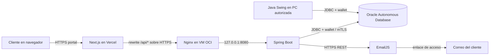
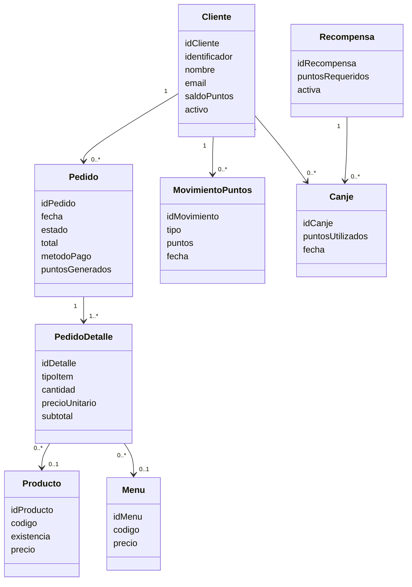

# Arquitectura y módulos

**Proyecto:** Pan, Puntos y Premios  
**Actualizado:** 13 de octubre de 2026

## Propósito

El repositorio mantiene dos aplicaciones que comparten el dominio y Oracle Autonomous Database:

1. **Aplicación de escritorio Java Swing:** operación del establecimiento: clientes, productos, menús, inventario, pedidos, cobros, puntos, canjes y reportes.
2. **Portal web para clientes:** Next.js en Vercel llama una API Spring Boot en OCI. Cada cliente solicita un enlace por correo y consulta únicamente su propio perfil, puntos e historial.

El portal no es un panel de caja ni administración. La aplicación Swing sigue siendo la interfaz para la operación interna.

## Arquitectura desplegada

El navegador conserva un mismo origen: solicita `/api/...` al dominio Vercel y Next.js aplica un rewrite al backend. Spring Boot no se ejecuta en Vercel. En OCI, Nginx termina HTTPS y reenvía las solicitudes al servicio local Spring Boot. La API y Swing tienen conexiones distintas; el portal utiliza `APP_PUNTOS_API`, mientras que Swing puede usar `ADMIN` u otra cuenta aprobada con sus variables `SWING_DB_*`.

## Componentes y módulos

| Aplicación/capa | Módulo | Responsabilidad |
|---|---|---|
| Swing | `vista` | Ventana principal y formularios de clientes, catálogo, menús, inventario, pedidos, cobros, reportes, puntos y canjes. Las operaciones largas se realizan de forma asíncrona donde aplica. |
| Swing | `servicio` | Reglas de clientes, productos, menús, abastecimiento, pedidos, ventas/cobros, reportes y puntos/canjes; aplica validaciones y límites transaccionales. |
| Swing | `dao` | Consultas y persistencia JDBC contra Oracle para clientes, productos, menús, movimientos, pedidos, pagos, recompensas, canjes y reportes. |
| Swing | `modelo`, `enums`, `excepcion` | Entidades/registros del dominio, estados y tipos permitidos, y errores de negocio identificables. |
| Compartido | `util` | Conexión Oracle y coordinación transaccional. La configuración Swing está separada de `DB_*` de la API. |
| API | `controller` | Endpoints REST para salud, autenticación y datos del cliente autenticado. |
| API | `servicio` | Solicitud y consumo de enlaces, envío de correo, límites de solicitudes y consulta de perfil/saldo/movimientos. |
| API | `dao` | SQL JDBC que valida tokens y consulta los datos personales en el esquema `ADMIN` mediante la cuenta de servicio. |
| API | `config`, `modelo`, `dto`, `excepcion` | Spring Security, principal autenticado, objetos de entrada/salida y respuestas de error. |
| Web | `frontend/src/app` | Página de solicitud de acceso y página de callback que consume el token; estados de sesión y presentación del saldo/historial. |
| Web | `frontend/next.config.ts` | Rewrite de `/api/:path*` al origen configurado en `SPRING_API_ORIGIN`. |
| Infraestructura | OCI VM | Ejecuta Linux, Spring Boot como servicio `pan-puntos-api`, Nginx, Certbot y wallet Oracle privado. |
| Infraestructura | Vercel | Construye y publica el portal Next.js; no almacena credenciales Oracle, wallet ni claves privadas de correo. |

### Módulos funcionales de Swing

- **Clientes:** búsqueda, alta/edición y consulta relacionada de clientes.
- **Catálogo e inventario:** productos, menús con componentes, abastecimiento y movimientos de inventario.
- **Pedidos:** creación de pedidos pendientes, detalle y anulación mientras son pendientes.
- **Cobro y comprobantes:** pago simulado con efectivo/tarjeta, cambio, comprobante, descuento de existencias, acreditación de puntos y entrega.
- **Puntos y canjes:** saldo e historial, catálogo de recompensas y canje atómico con validación de puntos y existencias.
- **Reportes:** seis reportes académicos obligatorios más consultas complementarias.

## Contrato de la API web

| Método y endpoint | Acceso | Función |
|---|---|---|
| `GET /api/v1/health` | Público | Estado de API y conexión configurada a la base. |
| `POST /api/v1/auth/access-requests` | Público, limitado | Solicita enviar un enlace a la dirección de correo registrada; responde con mensaje genérico. |
| `POST /api/v1/auth/consume` | Público | Consume una sola vez el token recibido en el fragmento de la URL y crea la sesión. |
| `POST /api/v1/auth/logout` | Sesión | Invalida/cierra la sesión del cliente. |
| `GET /api/v1/me` | Sesión | Perfil del cliente autenticado. |
| `GET /api/v1/me/points` | Sesión | Saldo de puntos actual. |
| `GET /api/v1/me/points/movements` | Sesión | Movimientos paginados del cliente autenticado. |

Los endpoints `/me/**` derivan el cliente desde el principal de Spring Security; no reciben un ID para escoger la cuenta. Las respuestas personales usan política `no-store`. La cookie de sesión es manejada por el servidor; no se usa `localStorage` para guardar credenciales o tokens de sesión.

## Modelo funcional resumido

El esquema Oracle compartido ya existe. Antes de ejecutar scripts, revisa `README.md` y la guía operativa: los scripts iniciales son para una base aislada y no se deben aplicar a producción.

## Límites y decisiones conocidas

- La aplicación de escritorio y el portal no comparten proceso ni sesión; solo comparten los datos persistidos.
- El pago con tarjeta del proyecto es un simulador y no procesa datos bancarios.
- EmailJS se invoca desde backend; sus claves privadas deben permanecer en el `.env` de OCI.
- No se ha hecho un cambio de red para la Fase 9. El usuario prefiere mantener la VM estable; las restricciones SSH/ACL se registran como endurecimiento aplazado.
- Para comandos y mantenimiento de infraestructura usa [`GUIA_DESPLIEGUE_OCI_VERCEL.md`](GUIA_DESPLIEGUE_OCI_VERCEL.md); para la aceptación de seguridad usa [`FASE9_ACEPTACION_SEGURIDAD.md`](FASE9_ACEPTACION_SEGURIDAD.md).
