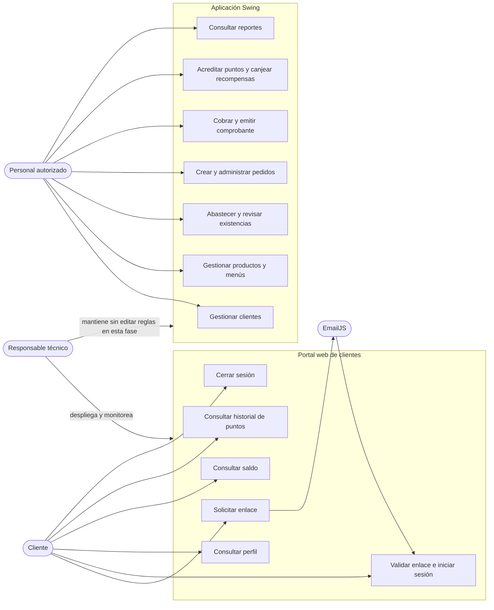

# Casos de uso

## Actores

| Actor | Sistema | Objetivo |
|---|---|---|
| Cliente | Portal web | Acceder por enlace de correo y consultar sus puntos e historial. |
| Personal autorizado | Aplicación Swing | Operar clientes, catálogo, inventario, pedidos, cobros, recompensas y reportes. No es un rol del portal web. |
| Servicio de correo EmailJS | API | Entregar al correo del cliente el enlace temporal de acceso. |
| Operador/desarrollador | OCI/Vercel | Mantener el despliegue, revisar salud y publicar versiones autorizadas. |
| Oracle Autonomous Database | Persistencia | Almacenar los datos compartidos por las aplicaciones. |

## Mapa de casos de uso

## Casos de uso del portal

### CU-WEB-01 — Solicitar enlace de acceso

- **Actor principal:** cliente.
- **Precondiciones:** cliente activo con correo registrado; API y servicio de correo disponibles.
- **Disparador:** el cliente introduce su correo en la página de acceso.
- **Flujo principal:**
  1. El portal envía `POST /api/v1/auth/access-requests` por el rewrite de Vercel.
  2. Spring valida formato, límites y reglas de envío.
  3. Si aplica, genera token aleatorio, guarda su hash con vencimiento/uso único y solicita a EmailJS enviar el enlace.
  4. La API responde con un texto genérico que no revela si la cuenta existe.
  5. El cliente abre el correo y selecciona el enlace.
- **Alternativas:** correo inválido, cliente inactivo/no registrado, cuota o cooldown, proveedor temporalmente no disponible. La respuesta pública evita confirmar la existencia de una cuenta.
- **Postcondición:** token temporal asociado a la cuenta cuando se genera; el token original se entrega en el fragmento `#token=...`, no como query string.

### CU-WEB-02 — Consumir enlace e iniciar sesión

- **Actor principal:** cliente.
- **Precondiciones:** enlace vigente, no usado y token de acceso presente en el fragmento.
- **Flujo principal:**
  1. El navegador abre `/auth/callback` y la página lee el fragmento localmente.
  2. El frontend envía el token a `POST /api/v1/auth/consume` y limpia el token de la URL.
  3. El backend calcula el hash, valida vencimiento/uso y consume el token dentro de una transacción.
  4. En el primer acceso, verifica el correo; Spring establece la sesión del cliente.
  5. El portal carga `/api/v1/me`.
- **Alternativas:** token ausente, vencido, incorrecto o ya usado; no se crea sesión y se ofrece solicitar un enlace nuevo.
- **Postcondición:** navegador autenticado mediante cookie de sesión; token consumido no puede reutilizarse.

### CU-WEB-03 — Consultar puntos propios

- **Actor principal:** cliente autenticado.
- **Precondiciones:** sesión válida.
- **Flujo principal:** portal solicita `/api/v1/me/points`; el backend extrae `id_cliente` de `ClientePrincipal`, consulta Oracle y responde sin caché.
- **Alternativas:** sesión expirada devuelve `401`; error de base se presenta como fallo de carga sin exponer detalles SQL al cliente.
- **Regla de autorización:** no existe parámetro de cliente para consultar el saldo de otra persona.

### CU-WEB-04 — Consultar movimientos propios

- **Actor principal:** cliente autenticado.
- **Precondiciones:** sesión válida.
- **Flujo principal:** portal solicita `/api/v1/me/points/movements`, opcionalmente con `limit` y cursor `before`; el backend pagina usando el cliente autenticado.
- **Alternativas:** límite fuera del rango permitido se valida/rechaza; sesión inválida devuelve `401`.

### CU-WEB-05 — Cerrar sesión

- **Actor principal:** cliente autenticado.
- **Flujo principal:** frontend obtiene/manda CSRF cuando corresponda y ejecuta `POST /api/v1/auth/logout`; backend invalida sesión y limpia cookie; portal regresa a pantalla de solicitud.

## Casos de uso de escritorio

### CU-DESK-01 — Administrar catálogo e inventario

Personal autorizado consulta/crea/actualiza productos y menús, registra abastecimientos y revisa movimientos. El servicio valida cantidades, precios, composición del menú y existencia; DAO escribe en Oracle.

### CU-DESK-02 — Crear, editar o anular pedido pendiente

Personal busca cliente activo, agrega productos o menús y confirma un pedido pendiente. Los precios y puntos previstos quedan asociados al pedido. No reserva existencias. El pedido pendiente puede cambiarse o anularse de acuerdo con las reglas del servicio.

### CU-DESK-03 — Cobrar pedido

Personal consulta un pedido y elige efectivo o tarjeta simulada. El servicio valida estado, importe, actividad y existencias; en una transacción registra venta, descuenta productos/componentes, crea movimientos de inventario y puntos, calcula puntos y actualiza el pedido. Rechazo o error revierte los cambios.

### CU-DESK-04 — Canjear recompensa

Personal identifica cliente y recompensa; el servicio valida puntos/actividad/stock, bloquea registros en un orden consistente y guarda descuento, movimiento de puntos y canje en una transacción. Si una validación falla, no quedan escrituras parciales.

### CU-DESK-05 — Consultar reportes

Personal escoge uno de los seis reportes obligatorios o una consulta complementaria. El formulario valida rango si aplica, servicio llama DAO y presenta filas en `JTable`. Los seis reportes obligatorios se compararon con SQL de solo lectura en Oracle en octubre de 2026.

## Trazabilidad rápida

| Caso | Código principal |
|---|---|
| Acceso/correo | `AuthController`, `AuthService`, `AuthDAOImpl`, `EmailService` |
| Callback web | `frontend/src/app/auth/callback/page.tsx` |
| Saldo/perfil/movimientos | `PuntosController`, `PuntosConsultaService`, `PuntosConsultaDAOImpl` |
| Pedido/cobro | `FormPedido`, `FormCobro`, `PedidoServicio`, `VentaServicio` |
| Canje | `FormPuntosYCanjes`, `PuntosYCanjesServicio` |
| Reportes | `FormReportes`, `ReporteServicio`, `ReporteDAOImpl` |
