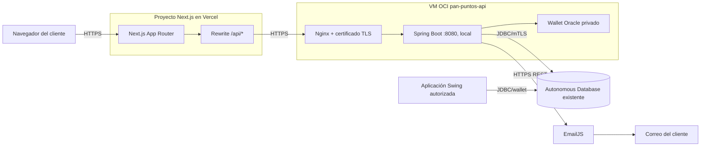
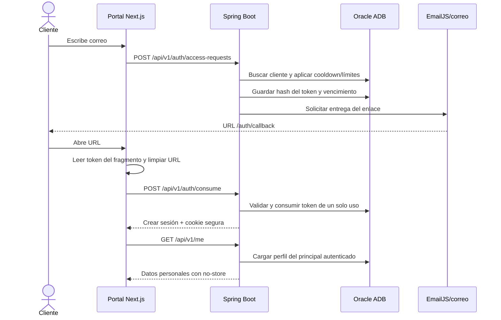
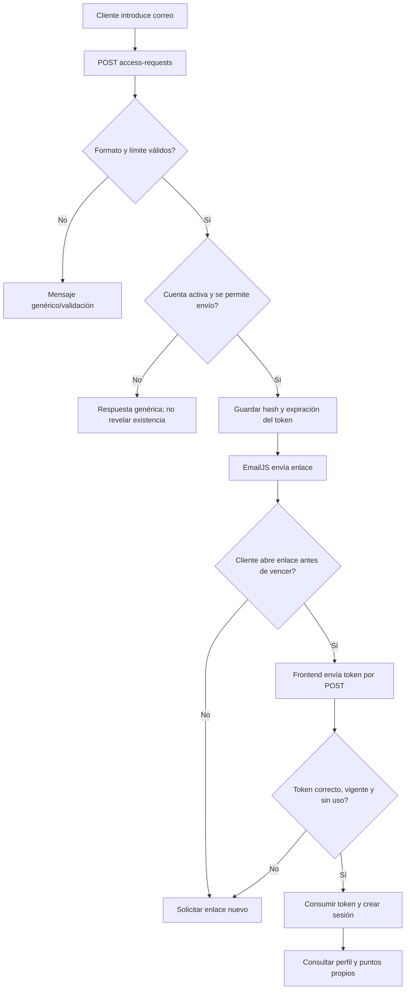
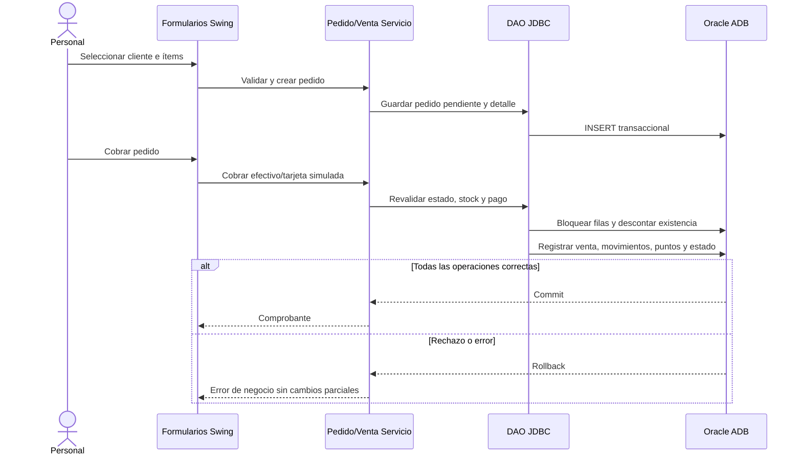
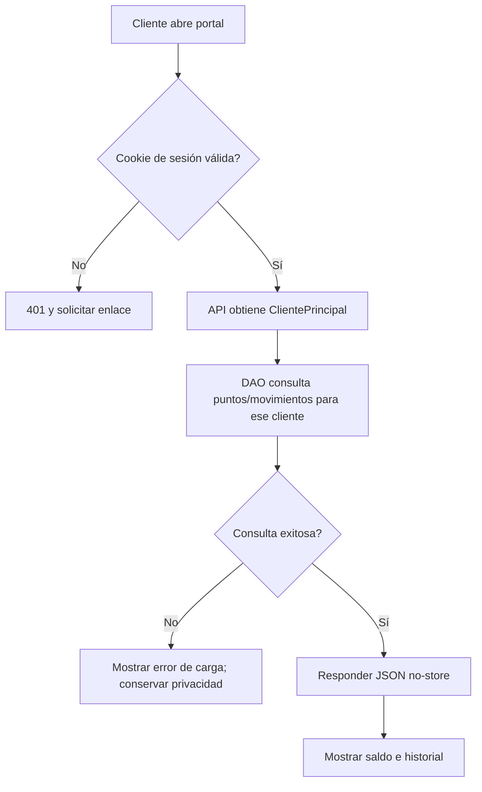
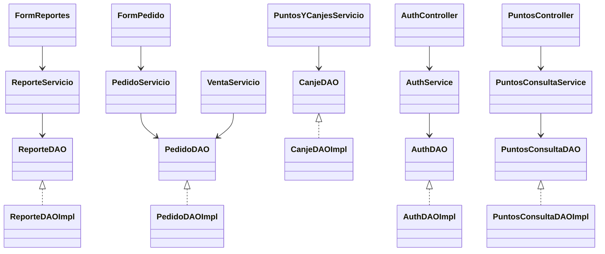

# Diagramas UML y flujos

Los diagramas se mantienen como Mermaid para poder editarlos junto con el código. GitHub y varios editores Markdown pueden renderizarlos; si el visor no lo hace, conserva los bloques de código o utiliza un renderizador Mermaid.

## 1. Despliegue

## 2. Secuencia de autenticación por enlace

## 3. Actividad: solicitud e inicio de sesión

## 4. Secuencia de pedido y cobro en Swing

## 5. Actividad: consulta de puntos

## 6. Clases por capas

